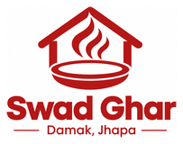

<!-- ======================= HEADER ======================= -->

  

<h1 align="center">Hi 👋, I'm Alshan Rijal</h1>

  

  
  
  

<!-- ======================= ABOUT ======================= -->
👨‍💻 About Me
<table>
<tr>
<td width="50%" valign="top">
🚀 What I'm Building

  
Currently working on Swad Ghar (Damak, Jhapa), a project I'm building from the ground up, turning an idea into software people can actually use.
I enjoy turning ideas into practical software and experimenting with AI/ML technologies.
</td>
<td width="50%" valign="top">
📚 What I'm Learning
🤖 Artificial Intelligence & Machine Learning
🐍 Python
☁️ AWS & Cloud Computing
🌐 Full-Stack Development
⚛️ MERN Stack
🧠 AI model development, training & deployment
</td>
</tr>
</table>

<!-- ======================= PROJECTS ======================= -->
🚀 Featured Projects

  <i>Pinned from my GitHub profile. Click any card to open the repository.</i>

<table align="center">
<tr>
<td width="50%" align="center">
  
</td>
<td width="50%" align="center">
  
</td>
</tr>
<tr>
<td width="50%" align="center">
  
</td>
<td width="50%" align="center">
  
</td>
</tr>
<tr>
<td width="50%" align="center">
  
</td>
<td width="50%" align="center">
  
</td>
</tr>
</table>

  

<!-- ======================= TECH STACK ======================= -->
🛠️ Languages & Tools
💻 Languages

  

🌐 Web Development

  

  

🗄️ Databases & Backend

  

🤖 AI / Machine Learning

  

☁️ Cloud & Development Tools

  

<!-- ======================= CURRENT FOCUS ======================= -->
🎯 Current Focus
<table align="center">
<tr>
<td align="center" width="20%">
  🤖 
  <b>AI / ML</b>
</td>
<td align="center" width="20%">
  🐍 
  <b>Python</b>
</td>
<td align="center" width="20%">
  🌐 
  <b>Full-Stack</b>
</td>
<td align="center" width="20%">
  ☁️ 
  <b>Cloud</b>
</td>
<td align="center" width="20%">
  🔬 
  <b>Research</b>
</td>
</tr>
</table>

  Building intelligent systems, learning modern technologies,
  and turning ideas into practical applications.

<!-- ======================= WHAT I BUILD ======================= -->
💡 What I Like Building
<table align="center">
<tr>
<td align="center">
  🤖 
  <b>AI Systems</b>
</td>
<td align="center">
  🧠 
  <b>Machine Learning</b>
</td>
<td align="center">
  🐍 
  <b>Python</b>
</td>
<td align="center">
  ⚙️ 
  <b>APIs & Backend</b>
</td>
<td align="center">
  🌐 
  <b>Full-Stack Apps</b>
</td>
</tr>
</table>

<!-- ======================= GITHUB ======================= -->
📈 GitHub

  

  <i>Check my GitHub profile for my live contribution graph, repositories and activity.</i>

<!-- ======================= CONNECT ======================= -->
🤝 Let's Connect

  <a href="https://alshanrijal.com.np">
    🌐 alshanrijal.com.np
  </a>
  &nbsp; • &nbsp;
  <a href="mailto:contact@alshanrijal.com.np">
    ✉️ contact@alshanrijal.com.np
  </a>

<!-- ======================= PROFILE VIEWS ======================= -->

  

  <b>💡 Debug. Build. Learn. Repeat.</b>

  <i>Always learning. Always building.</i>

<!-- FOOTER -->

  

